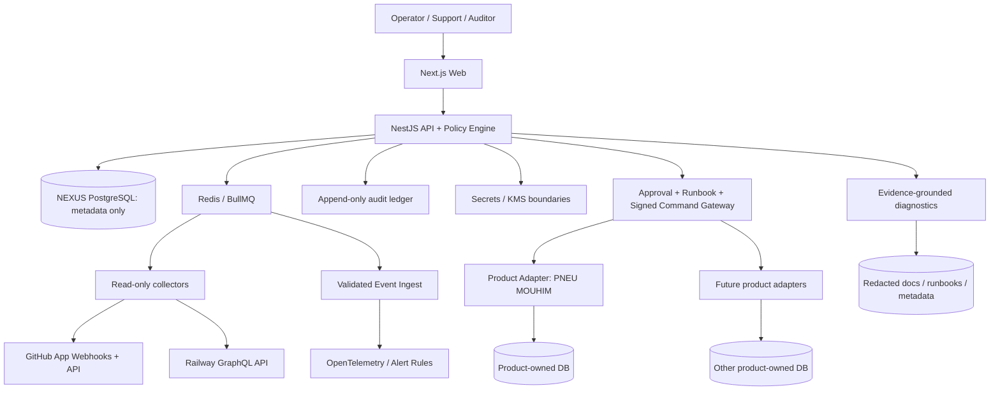

# 02 — Reference architecture

## Selected technical direction (proposed; no implementation yet)
| Layer | Selected approach | Why |
|---|---|---|
| Web UI | Next.js + React + TypeScript, Tailwind and accessible component library | RTL/FR, rich interactive consoles, responsive |
| API | NestJS TypeScript modular monolith | one audited permission boundary, typed contracts |
| Database | PostgreSQL + Prisma migrations | relational integrity and reproducible change history |
| Jobs | Redis + BullMQ | ingestion, polling, retries, backoff, dead-letter |
| Events | transactional outbox/inbox + idempotency keys | avoid duplicate action delivery and ambiguous outcomes |
| Observability | OpenTelemetry (traces, metrics, logs), OTel Collector | portable instrumentation |
| Dashboards (optional) | Grafana + Prometheus/Loki/Tempo as scale requires | flexible backend, avoid premature infra complexity |
| Search | PostgreSQL full text initially; pgvector only if retrieval is justified | avoid separate search cluster early |
| Documents | S3-compatible encrypted evidence storage (redacted only) | durable evidence, retention controls |
| Identity | OIDC with MFA; app-specific RBAC + ABAC | provider-independent user identities and scoped actions |
| Delivery | GitHub Actions + Railway (separate environments); Docker for repeatability | ties to current operations |
| QA | Vitest, Playwright, contract tests, security tests and restore drills | measurable protection |
| SDK | lightweight adapters in Laravel/PHP and TypeScript; future Python | same wire contracts across stacks |

Before coding: pin tested supported versions and write ADRs for OIDC, repository structure, tenancy and log retention. Never rely on ChatGPT/GitHub/Railway conversational connectors as the production credentials of NEXUS: create dedicated app-owned connections/scoped tokens.

## System diagram


## Trust zones
- Zone A: Browser. Sessions with CSRF protection, MFA, session binding and no connector tokens.
- Zone B: NEXUS API / Jobs. Authorization on every object and action, isolated service accounts, egress controls.
- Zone C: Provider API (GitHub/Railway): per-project least-privilege token, token rotation, rate limits.
- Zone D: Product adapter: separate short-lived signed request verification, independent authorization and idempotent execution.
- Zone E: Product business database: **never mounted or connected with generic credentials from NEXUS**.
- Zone F: 2M private network: only explicitly sanctioned outbound authenticated relay; never force exposure of company systems.

## Message processing
1. Provider webhook/poll or product event arrives -> verify origin/signature -> reject oversized/malformed payload -> redact -> deduplicate.
2. Validate versioned schema -> store immutable evidence reference and normalized event -> correlate by app/env/deployment/trace.
3. Rule engine evaluates health, SLO and business-integrity counters -> alert/incident if threshold met.
4. Assistant searches redacted evidence and approved documentation -> cites evidence -> suggests runbook, never performs direct edits.
5. Action request -> policy check -> human approval if needed -> preflight -> signed one-time dispatch to adapter.
6. Adapter validates independently, runs *native application service*, records local audit, returns receipt.
7. NEXUS fetches verification evidence, marks outcome succeeded/failed/unknown, never assumes success on timeout.

## Reliability and non-functional targets
- NEXUS outage must not block sale, rental, delivery, clinic or monitoring workflows in the source apps.
- Polling and ingestion at-least-once; consumers idempotent; out-of-order event timestamps preserved.
- Inbound events use bounded queues, backpressure and dead-letter review; metrics are low cardinality.
- Commands fail closed, expire rapidly, never retried blindly after an unknown outcome; reconcile status first.
- Environments separated (dev/staging/production); encryption in transit/at rest, retention and export policies.
- Define SLOs per app/operation, RTO/RPO per service and independent restore-test evidence.
- Design first as a modular monolith, then split high-volume telemetry only when measurement justifies it.

## Suggested repository layout (target only)
```text
apps/web/                 # responsive dashboard, AR/FR
apps/api/                 # modules: auth, registry, topology, ingest, incidents,
                          # diagnostics, runbooks, actions, approvals, audit
apps/worker/              # polling, scheduled checks, summaries, retries
packages/contracts/       # generated types/OpenAPI and JSON Schemas
packages/ui/              # shared design system
packages/sdk-php/         # PNEU MOUHIM / Laravel adapter
packages/sdk-ts/          # Node adapters
infra/                    # Docker/Railway, OTel, security policies
docs/                     # ADRs, runbooks, diagrams, threat model
```
