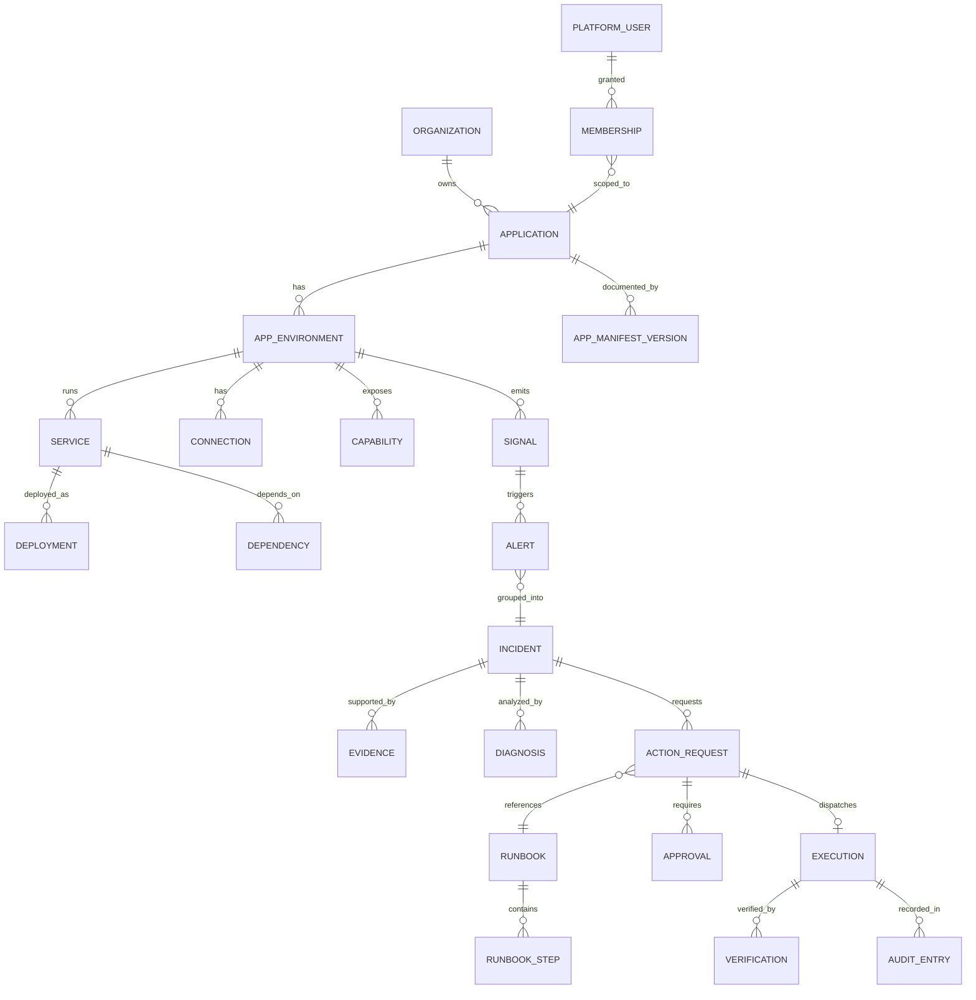

# 03 — Domain model and relationships

## Data boundary
NEXUS stores **operational metadata**, not domain rows. The target application is source of truth for customer, tenant, financial, patient, stock, sales and document data. Cross-platform identifiers are **opaque** with no plaintext personal identity; avoid customer-level references unless a product-approved support process needs a short-lived opaque token.

## Relationship diagram

## Main entities / keys
| Table | Primary fields | Non-negotiable constraints |
|---|---|---|
| organizations | id, slug, name, classification | slug UNIQUE |
| applications | id, organization_id, slug, lifecycle, owner_team | UNIQUE(organization_id, slug) |
| environments | id, application_id, key, classification, criticality | UNIQUE(application_id, key) |
| services | id, environment_id, provider_ref, runtime_kind | provider_ref uniqueness scoped by environment |
| deployments | id, service_id, commit_sha, status, started_at | immutable provider deployment references |
| dependencies | from_service_id, to_service_id, kind | prevent duplicate / invalid self edges |
| connections | id, environment_id, provider, vault_secret_ref, scope, expiry | **never credentials in DB/logs** |
| capabilities | id, environment_id, name, contract_version, risk, enabled | UNIQUE(environment_id, name, contract_version) |
| signals | id, environment_id, event_id, type, observed_at, payload_redacted | UNIQUE(environment_id, event_id) |
| alerts | id, signal_id, rule_id, severity, state | source correlation |
| incidents | id, environment_id, key, severity, status, opened_at | environment ownership and SLA |
| incident_evidence | id, incident_id, signal_id, artifact_ref, checksum | no raw PII or credentials |
| diagnoses | id, incident_id, evidence_refs, hypothesis, confidence | source attribution, not authoritative |
| runbooks | id, slug, version, owning_team, risk | immutable version history |
| action_requests | id, environment_id, capability_id, actor_id, idempotency_key, status, expires_at | UNIQUE(environment_id, idempotency_key) |
| approvals | id, action_request_id, reviewer_id, decision, at | no self-approval when 2-person required |
| executions | id, action_request_id, target_receipt, status, started_at | UNIQUE(action_request_id) |
| verifications | id, execution_id, result, checked_at, evidence_ref | independently checks postconditions |
| audit_entries | id, actor, app/env scope, action, decision, hash, prev_hash | append-only, external retention option |
| users / memberships | id, identity_subject, role, scoped_app/environment | deny-by-default, no global cross-app leak |
| manifests | app_id, version, sha, status, discovered_at | source/document/approval provenance |

Design notes:
- All cross-application queries require an explicit organization + app/environment scope. Enforce in authorization and database access patterns, not UI filtering alone.
- Ingestion schemas use an event_id (UUID), event time, type, source service, correlation/trace IDs, anonymized attributes and schema version.
- Sensitive log payloads expire by policy; credentials never enter observability pipelines. Data retention differs for incidents/audit/telemetry and follows actual legal obligations.
- Use append-only audit with external timestamped archival; hash chaining is tamper evidence, **not** immunity to an administrator with database control.
- Financial integrity checks produce PASS / FAIL / UNKNOWN + counts and rule version, not individual invoices or balances unless explicitly delegated.
- Place production secrets in secret manager/provider variables; NEXUS DB stores a reference only.

## Core state machines
- Incident: OPEN -> TRIAGED -> INVESTIGATING -> MITIGATING -> VERIFYING -> RESOLVED -> CLOSED; can REOPEN.
- Action: DRAFT -> POLICY_CHECKED -> AWAITING_APPROVAL -> APPROVED -> PREFLIGHTED -> DISPATCHED -> (SUCCEEDED | FAILED | UNKNOWN); UNKNOWN requires reconciliation.
- Backup: SCHEDULED -> RUNNING -> (FAILED | STORED) -> VERIFIED_INTEGRITY -> RESTORE_TESTED. 'Stored' is not 'restorable'.
- Connection: DISCOVERED -> CREDENTIALS_PENDING -> VALIDATING -> (ACTIVE | DEGRADED | REVOKED).

DB design must add ownership indexes, FK cascades carefully (do not cascade delete audit/evidence), time-based partitions for high-volume telemetry after measurement, and SQL/ORM migrations with rollback tests.
