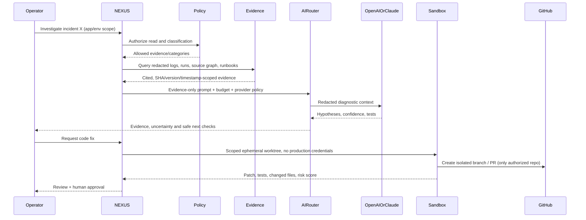

# 15 — OpenAI, Claude and governed coding agents

**Design recorded 2026-11-17. Not implemented or connected.**

## Separate three products
1. **Embedded analysis assistant** uses developer APIs (OpenAI Responses API or Anthropic Claude Messages API); NEXUS chooses provider/model per app policy and budget.
2. **Code assistant** uses Claude Code / Claude Agent SDK (or a future isolated coding worker) to inspect a permitted *snapshot* and propose code changes/tests.
3. **ChatGPT conversation or Claude subscription** is a user interface and is **not itself an automatically reusable backend credential**, deployment service or blanket API permission.

## Architecture

## Grounded assistant capabilities
- Explain routes, owners, schema edges, permissions and dependency impact for a pinned code SHA.
- Correlate deployment diff, exception fingerprint, log line, migration and system status.
- Propose runbook, targeted tests and verification steps with source citations.
- Summarize failing CI and a small patch; classify risk based on changed files/critical routes.
- Ask human for missing information rather than guessing an unknown root cause.
- Never bypass source-app policies or execute automatic R3/R4 production changes.

## Privacy, security and budgets
- Provider switch is **per app/environment**, not globally allow all data. NEXORA medical and TECH PLATFORM private data require explicit review and can disable cloud LLM inference entirely.
- Input is minimised/redacted; prompt injection from logs and source comments is treated as untrusted content.
- Provider API keys live in secret vault; no frontend exposure or output logging.
- User/incident attribution, model name and usage/cost summary recorded without storing sensitive prompts.
- Token/time/cost ceilings, model fallback, circuit-breaker and immutable evidence trace.
- Coding runner has isolated filesystem, scoped GitHub installation, no production Railway token/DB credentials, default-deny network, resource/time limits and user-approved tool allowlist.
- AI patch is proposed as PR; automated tests, security scanning, maintainer review and deployment gates apply. AI cannot merge or publish merely by asserting success.
- Do not interpret model 'fixed' as operational fix; measure source staging and production results separately.

## Initial integration plan
P0: deterministic diagnostics and knowledge graph without LLM dependency.
P1: integrate one text-only redacted analysis provider with feature flag, quotas and citations; optional second provider for comparison.
P2: approved isolated coding agent + PR workflow + human review; evaluate model-quality regressions, output toxicity/data leak and cost.

References:
- https://platform.openai.com/docs/api-reference/responses
- https://platform.claude.com/docs/en/build-with-claude/overview
- https://platform.claude.com/docs/en/cli-sdks-libraries/overview
